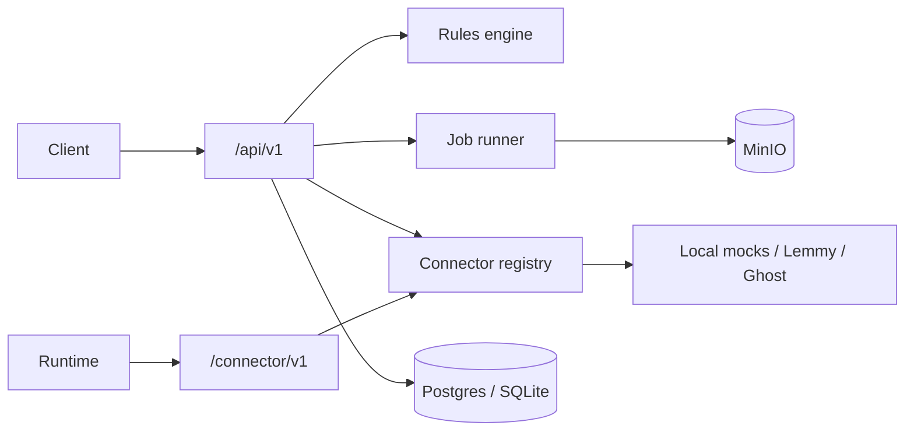

# IncuBrix Long-Tail Distribution (Assessment 4)

Containerised **Python 3.11 + FastAPI** connector service for long-tail publishing destinations (Discourse, Lemmy, Dev.to, Ghost, HMAC webhook, assisted manual pack).

## Architecture



## Live demo (cloud, laptop off)

Deploy to **Render** with the included blueprint — see **[docs/DEPLOY.md](docs/DEPLOY.md)** for step-by-step (GitHub → Blueprint → HTTPS URL + demo token).

## Quick start

```bash
cp .env.example .env
python -m venv .venv
.venv\Scripts\activate
pip install -r requirements.txt
uvicorn app.main:app --reload
```

Docker (API + Postgres + platform mocks; MinIO optional):

```bash
docker compose up --build
```

- API: http://localhost:8000/docs  
- Mocks: http://localhost:8080/health  

With object storage (after `docker login` if Hub blocks anonymous pulls):

```bash
docker compose --profile minio up --build
```

Set `S3_ENABLED=true` on the `api` service when using the `minio` profile.

**MinIO pull errors** (`pull access denied` / `repository does not exist`): sign in with `docker login`, then retry. The default `docker compose up` does **not** require MinIO (`S3_ENABLED=false`).

## Tests

```bash
pytest
```

E2E tests spin up an in-process **mock platform** (no Docker required). Certification evidence:

```bash
# API must be running (docker compose or uvicorn)
python scripts/run_certification.py --base-url http://localhost:8000
```

## Batch runner

```bash
python scripts/batch_runner.py --input tests/fixtures --output out/batch
```

## Connector contract (Appendix A)

`POST /connector/v1/{connector_key}/{method}` with JSON body:

- `validate`, `publish`, `get_status`, `delete`, `fetch_metrics`, `refresh_auth`, `build_assist_pack` (assisted)

Manifests: `connectors/manifests/*.yaml`

## HTTP API (`/api/v1`)

| Route | Description |
|-------|-------------|
| `GET /health`, `GET /ready` | Liveness / readiness |
| `GET /destinations` | Catalogue |
| `POST /destinations` | Add destination (config row) |
| `POST /destinations/{id}/certify` | Async certification job |
| `POST /publish` | Publish job (`Idempotency-Key` header) |
| `POST /validate` | Rules + spec check |
| `GET /jobs/{job_id}` | Job status |

## Error codes

| Code | Retry? |
|------|--------|
| `DEST_SPEC_VIOLATION` | No |
| `DEST_RULE_FREQUENCY_CAP` | Later |
| `CONNECTION_AUTH_EXPIRED` | After reconnect |
| `PLATFORM_RATE_LIMIT` | Yes |
| `PLATFORM_QUOTA_EXHAUSTED` | Next window |
| `PLATFORM_CONTENT_REJECTED` | No |
| `PLATFORM_UNAVAILABLE` | Yes |
| `CONNECTOR_DISABLED` | No |

## Settings

See `.env.example`. **Simulation mode** defaults to `true`; mocks require no API keys.

On startup, **SQLite** databases are auto-migrated when new columns are added to models. If you still see schema errors, delete `data/outpost.db` and restart (fresh seed).

## Advanced features

| Feature | Endpoints |
|---------|-----------|
| AI rules capture (mock adapter) | `POST /destinations/{id}/rules/propose`, `POST .../confirm` |
| Tailoring | `POST /tailor` (also applied on publish when `tailor` is true) |
| Metrics (Discourse, Dev.to, Ghost) | `GET /metrics`, `POST /metrics/fetch` |
| Recertification | Background scheduler + `GET /alerts/recertification` |

Regenerate OpenAPI:

```bash
python scripts/export_openapi.py
```

## Recommender (Outstanding)

| Route | Purpose |
|-------|---------|
| `POST /api/v1/recommend` | Rank destinations with score + reason |
| `POST /api/v1/recommend/evaluate` | Macro precision@10 on labelled set |
| `POST /api/v1/recommend/evaluate/upload` | Async eval for custom JSON |

Labelled set: `catalogue/evaluation_labelled.json`

```bash
python scripts/run_recommender_eval.py --base-url http://localhost:8000
```

Optional: expand to 150+ real catalogue-only destinations for the submission spreadsheet.
